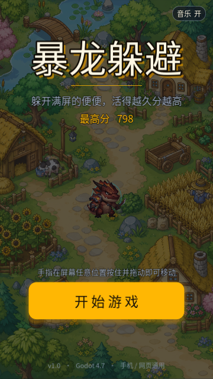
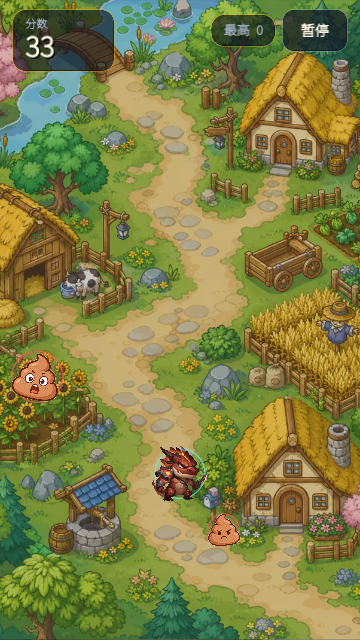
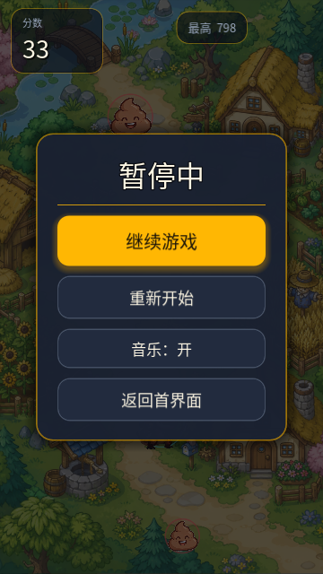
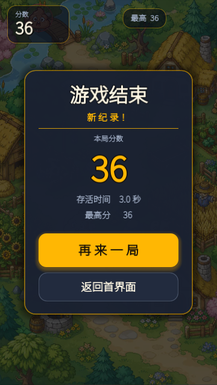

# 暴龙躲避 · Godot 4.7 示例工程

一个**完整可运行**的 2D 躲避游戏最小工程，中文界面，同时适配手机竖屏与网页端。
配套文档：[开发流程.md](开发流程.md)（从零到发布的完整流程）、[导出与发布.md](导出与发布.md)。

## 🎮 在线试玩

**https://cccwwwhhh222.github.io/dodge-game/**

手机浏览器直接打开这个网址就能玩（单指拖动），电脑上也可以。

- **首屏只需下载 11.4 MB**（原来 49.2 MB），宽带下 2~4 秒进游戏，4G 大约 8 秒
- 加载时先显示「暴龙躲避」的进度页，不会白屏干等
- 点「开始游戏」之后背景音乐才会响（浏览器自动播放限制）
- 极老的浏览器若解压不了，打开 `?raw=1` 走兼容模式（慢但一定能跑）

> 站点由 GitHub Pages 托管，发布源是本仓库的 `docs/` 目录。
> 更新：重新导出 Web 到 `build/web` → `gzip` 出 `index.wasm.gz` → 复制到 `docs/` → 提交推送（见「体积优化」）。

---

> ✅ 已用 **Godot 4.7.2.stable.steam** 实跑验证：无头冒烟测试 **49 项全过**，
> 并截了首界面 / 战斗中 / 暂停 / 结算四张真机画面（见下表）。中文界面、背景音乐（循环）、音乐开关都已跑通。

| 首界面 | 战斗中 | 暂停 | 结算 |
| --- | --- | --- | --- |
|  |  |  |  |

---

## 体积优化（49.2 MB → 11.4 MB）

| 项目 | 前 | 后 | 做法 |
| --- | --- | --- | --- |
| 中文字体 | 8.09 MB | **0.25 MB** | 自写 glyf 子集器 `tools/subset_font.py`，只留界面用到的 629 个字形；用 `FontVariation.variation_embolden` 补回字重 |
| 引擎 wasm | 37.68 MB | **9.59 MB** | 自定义 HTML 加载页：下载 `index.wasm.gz`，用浏览器 `DecompressionStream` 本地解压后喂给引擎 |
| 资源包 pck | 11.25 MB | **1.49 MB** | 贴图有损导入（WebP）、背景降分辨率、音乐降到 q2 Vorbis |
| **首屏合计** | **49.2 MB** | **11.4 MB** | |

两个关键点：

1. **`.pck` 几乎压不动**（gzip 只少 0.1 MB），所以体积必须从源文件上砍——字体、贴图、音频都是源头处理。
2. **GitHub Pages 不会给 `.wasm` 做 gzip**，而 wasm 有 37.7 MB。既然改不了服务器，就自己压：
   `gzip -9 index.wasm` 得到 9.59 MB，页面里用 `DecompressionStream` 解压；
   `window.fetch` 被替换成「拦截 wasm 请求、返回解压后字节」的包装器，引擎完全无感。
   不支持 `DecompressionStream` 的环境自动回退到原始 `index.wasm`。

不需要浏览器也能验证这条链路：

```bash
node tools/loader_test.js
# [http] GET /index.wasm.gz 10054758      ← 只请求 gz，没请求 37MB 的 wasm
# wasm 内容完全一致     : true
# wasm MIME             : application/wasm
```

---

## 快速开始

1. Godot 项目管理器 → **导入** → 选择本目录的 `project.godot` → 打开。
2. 按 **F5** 运行（主场景已设为 `scenes/main.tscn`）。
3. 操作：
   - 桌面：`WASD` / 方向键，或**鼠标按住拖动**（和手机一样）
   - 手机/浏览器：**手指在屏幕任意处按下并拖动**（浮动摇杆，松手即停）
4. 首界面点「开 始 游 戏」→ 游戏中右上角「暂停」→ 可继续 / 重新开始 / 返回首界面。
   撞到便便后结算面板有「再 来 一 局」和「返回首界面」。最高分会自动保存。

---

## 界面结构（状态机）

```
HOME（首界面）──开始──▶ PLAYING（游戏中）──暂停──▶ PAUSED
   ▲                      │   ▲                    │
   │                   被撞死  └────继续────────────┘
   │                      ▼
   └────返回首界面──── GAME_OVER（结算）
```

- **首界面**：标题「暴龙躲避」+ 副标题 + 最高分 + 开始键，龙站在画面中间当看板（会呼吸上下浮动）。
- **游戏中**：左上「分数」胶囊、右上「最高 xxx」胶囊 + 「暂停」键。
- **暂停**：用 `get_tree().paused = true` 真正冻结敌人与计分；HUD 因为 `process_mode = ALWAYS` 仍可点击。
- **结算**：本局分数（大字）、存活时间、最高分、破纪录提示，加「再来一局 / 返回首界面」。
- **切后台自动暂停**（`NOTIFICATION_APPLICATION_FOCUS_OUT`），安卓返回键＝暂停 / 回首页。

样式统一在 `scripts/ui_kit.gd`（配色、圆角、按钮三态、入场动画），改一处全局生效。

---

## 玩法与数值

| 项 | 值 | 在哪里改 |
| --- | --- | --- |
| 设计分辨率 | 720×1280 竖屏 | `project.godot` |
| 玩家速度 | 430 px/s | `scripts/player.gd` → `@export speed` |
| 玩家加速度 | 6000 | `player.gd` → `acceleration` |
| 每秒得分 | 12 | `scripts/main.gd` → `SCORE_PER_SECOND` |
| 难度登顶时间 | 70 秒 | `main.gd` → `RAMP_TIME` |
| 刷怪间隔 | 0.95s → 0.22s | `main.gd` → `SPAWN_INTERVAL_*` |
| 敌人速度 | 170 → 360 px/s | `main.gd` → `SPEED_*` |
| 敌人半径 | 20~34 px | `main.gd` → `_spawn_enemy()` |
| 敌人贴图高度 | 判定半径 × 3 | `enemy.gd` → `_apply_look()` |
| 玩家龙的大小 | 贴图缩放 0.135（约 118 px 高） | `scenes/player.tscn` → `Sprite.scale` |
| 玩家判定半径 | 34 px（比视觉小一圈） | `scenes/player.tscn` → `CircleShape2D` |
| 背景压暗 | 16% | `main.tscn` → `BackgroundLayer/Tint.color.a` |
| 蛇形概率 | 35% | `main.gd` → `_spawn_enemy()` |
| 摇杆底盘半径 | 110 px | `scripts/touch_joystick.gd` → `@export base_radius` |

调参思路：先固定难度（把 `RAMP_TIME` 调到 999 即不递增），把手感调顺，再放开曲线。

---

## 素材

| 文件 | 用途 | 来源 |
| --- | --- | --- |
| `assets/dragon.png` | 主角（小龙战士） | 877×870 原图，`Sprite.scale = 0.135` |
| `assets/bg_farm.png` | 背景（农场） | 800×1070（已降分辨率），有损导入，等比铺满 |
| `assets/enemy_happy.png` | 敌人①（开心） | 由 `_poop_src.jpg` 抠图 |
| `assets/enemy_shocked.png` | 敌人②（惊恐） | 同上 |
| `assets/enemy_angry.png` | 敌人③（生气） | 同上 |
| `assets/_poop_src.jpg` | 三个表情的原图（1280×1280） | 只作为抠图源，运行时不加载 |
| `assets/audio/bgm.ogg` | 背景音乐（2:17.7，mono 44.1k Vorbis q2，0.86 MB） | 从你给的 mp4 里抽的音频 |
| `assets/fonts/NotoSansSC-Subset.ttf` | 中文字体子集（250 KB / 629 字形） | 系统 Noto Sans SC VF（OFL），由 `tools/subset_font.py` 生成 |
| `assets/fonts/ui_font.tres` | FontVariation：子集字体 + `variation_embolden=1.0` | 补回正常字重（原字体默认实例是 Thin） |
| `web/shell.html` | 自定义加载页 + wasm gzip 解压逻辑 | 基于 4.7.2 官方模板改写 |

> 原版 8 MB 的 `NotoSansSC-Regular.otf` 已经从仓库里移除，现在用的是子集版。
> **以后如果界面新增了汉字，必须重跑一次子集化**，否则新字会显示成方框：
>
> ```bash
> python tools/subset_font.py "C:\Windows\Fonts\NotoSansSC-VF.ttf" assets/fonts/NotoSansSC-Subset.ttf
> ```
>
> 它默认读取 `tools/_chars.txt`（从所有 `.gd` 里抽出来的字符集），新增文案后先重新生成这个文件。

抠图脚本：`python tools/cut_enemies.py` → 输出 `assets/enemy_*.png`（256×256 透明 PNG）。
要点（脚本注释里也写了）：**只删「和图片边框连通的白」**，所以白色眼球会被保留；
按连通块取 bbox，所以右下角水印不会被裁进去；缩放用预乘 alpha，避免白边。

---

## 背景音乐

从视频里抽音频（用 `imageio_ffmpeg` 自带的 ffmpeg，装 `pip install imageio-ffmpeg` 即可）：

```powershell
$ff = python -c "import imageio_ffmpeg; print(imageio_ffmpeg.get_ffmpeg_exe())"
& $ff -y -i 你的视频.mp4 -vn `
   -af "loudnorm=I=-16:TP=-1.5:LRA=11" `
   -c:a libvorbis -q:a 4 -ac 1 -ar 44100 assets/audio/bgm.ogg
```

- `-vn` 丢掉视频轨；`loudnorm` 把响度归一到 -16 LUFS（手游 BGM 的常用档位，避免忽大忽小）；
- **用 `.ogg` 不用 `.mp3`**：体积更小、循环无缝，Godot 网页/安卓都原生支持；
- 单声道（`-ac 1`）足够，能省一半体积；2:17 的曲子这里只有 1.12 MB。

游戏里怎么接的（`scenes/main.tscn` + `scripts/main.gd`）：

- `Bgm` 是 `AudioStreamPlayer`，`_setup_music()` 里把 `stream.loop = true` 再 `play()`；
- 暂停时 `bgm.stream_paused = true`（和 `get_tree().paused` 分开控制，更确定）；
- **音乐开关**：首界面右上角「音乐 开/关」、暂停面板里也有一个；状态存进 `user://` 存档，下次启动保持；
- 关闭不是停止播放，而是把 `volume_db` 压到 -80 dB——这样再打开时不会从头开始播。

> ⚠️ 网页端有**自动播放策略**：iOS Safari / Chrome 都要求「用户交互过」才能出声。
> 所以音乐在点过「开始游戏」之后才真正响起来，这是正常现象，别当成 bug。
> 想让首屏也有声音，得先让玩家点一下（我们的「开始游戏」正好就是这次交互）。
>
> 另外：这段音乐是从你提供的视频里抽的，**商用/上架前请确认版权**。

---

## 文件地图

```
project.godot                项目设置（Compatibility 渲染器、竖屏、4 个输入动作、Game 自动加载）
icon.svg                     图标
assets/                      美术资源（龙 / 农场背景 / 三个表情敌人）
tools/cut_enemies.py         从 _poop_src.jpg 抠出三个敌人贴图
scenes/
  main.tscn                  关卡总控：BackgroundLayer(背景+压暗) / Playfield / TouchLayer / HUD / Home
  player.tscn                玩家（Sprite2D 龙 + 光圈 + 椭圆投影 + 圆碰撞）
  enemy.tscn                 敌人（Sprite2D 表情 + 红色提示环 + 圆碰撞）
scripts/
  ui_kit.gd                  UI 工具箱：配色、字体、按钮/面板样式、入场动画（统一改这里）
  home_screen.gd             首界面（标题 / 副标题 / 最高分 / 开始游戏）
  game.gd                    Autoload「Game」：分数、最高分、user:// 存档
  main.gd                    四态状态机、刷怪、难度曲线、计分、暂停、震屏
  player.gd                  八方向移动（键盘 + 触屏双通道）+ 边界限制 + 死亡表现 + 左右翻转
  enemy.gd                   直线/蛇形移动、贴图缩放、碰到玩家发信号、出屏回收
  hud.gd                     游戏内 HUD + 暂停面板 + 结算面板
  touch_joystick.gd          浮动摇杆（多点触控、坐标换算、拖出底盘跟随）
  circle_visual.gd           _draw() 画圆/圆环：玩家脚下光圈、敌人提示环、椭圆投影
assets/
  fonts/NotoSansSC-Regular.otf  中文字体（OFL 授权，见 fonts/NOTICE.md）
  audio/bgm.ogg                 背景音乐（2:17，循环播放）
tests/
  smoke_test.tscn/.gd        无头冒烟测试（49 项断言，返回码即结果）
  capture.tscn/.gd           自动截图（首屏/战斗/暂停/结算）
  preview_*.png              真机画面截图
_check.py                    静态自检脚本（可选，需 Python）
export_presets.cfg           Web 导出预设（thread_support=false，可直接导出）
build/web/                   已导出好的网页版，起个 HTTP 服务器即可玩
```

---

## 换成自己的美术

**主角**：改 `scenes/player.tscn` 里 `Sprite` 的 `texture` 与 `scale`。
新图想显示成 H 像素高就设 `scale = H / 图片高度`。判定圆（`CollisionShape2D`）建议是视觉半径的 70~80%，
躲避游戏对玩家越宽容越好玩。`player.gd` 会自动按 `dir.x` 做 `flip_h`，侧面图不用另做左右两套。

**敌人**：`enemy.gd` 的 `_apply_look()` 会自动把贴图缩放到「判定半径 × 3」，你只要换
`main.gd` 顶部 `ENEMY_TEXTURES` 里的三张图，或直接改 `assets/enemy_*.png`（同名覆盖）。
贴图不会跟着飞行方向旋转（脸会歪），只做左右翻转 + 轻微倾斜。

**背景**：换 `main.tscn` 里 `Bg` 的 `texture` 即可。`stretch_mode = 6`（等比铺满）+
`expand_mode = 1`（忽略原始尺寸），任何宽高比都不会变形，只会裁边。

**背景很花时怎么保证看得清**（这套图已经踩过的坑）：

1. `BackgroundLayer/Tint` 加一层半透明暗罩（现在是 16%）；
2. 给敌人加红色提示环（`enemy.tscn` 的 `Halo`），因为便便是褐色、土路也是褐色；
3. 玩家加青色光圈（`player.tscn` 的 `Marker`），在草地里也能一眼找到自己；
4. 判定圆小于视觉尺寸，撞死时玩家不会觉得「明明没碰到」；
5. HUD 文字全部放在**半透明胶囊/面板**上，绝不直接压在图上看（「最高 xxx」最初就吃了这个亏）。

---

## 已知的简化

为了保持「够小、够读」，工程刻意没做这些（《开发流程》阶段 9/13 有做法）：

- **音效**（点击 / 死亡 / 得分提示音）——背景音乐已有，音效还没加
- 敌人对象池（现在用 `instantiate` + `queue_free`，同屏 30 个以内够用）
- 擦身得分 / 连击
- 敌人出生预警（0.3 秒闪烁）
- 中文字体子集化（现在整份 8 MB，网页发布前建议按 `assets/fonts/NOTICE.md` 压到 100~300 KB）

---

## 自检脚本

### 1. 静态检查（不需要引擎）

```bash
cd godot_dodge
python _check.py
```

检查内容：`.tscn` 的 `ext_resource` 路径是否存在、`SubResource` 是否声明、`load_steps` 是否匹配、
节点 `parent` 是否能解析、`@onready $路径` 是否能在对应场景里找到、信号 `connect` 是否有对应 `signal` 声明、
`.gd` 是否混用空格缩进、是否有 GDScript 不支持的 `\` 续行。

### 2. 无头冒烟测试（需要 Godot，不用开窗口）

```bash
# 你这台机器上的路径：
GODOT="D:\yingyong\steam\steamapps\common\Godot Engine\godot.windows.opt.tools.64.exe"

"$GODOT" --headless --path . --fixed-fps 60 res://tests/smoke_test.tscn
```

跑的是真实游戏链路（24 项断言）：场景加载 → HUD 搭建 → 点开始 → 触摸拖动摇杆 → 刷怪 → 计分
→ 撞死 → 结算 → 重开清场 → 边界限制。全过返回 0，任何一项失败返回 1，可直接当 CI 用。

### 3. 自动截图（会短暂弹窗）

```bash
"$GODOT" --path . --fixed-fps 60 --resolution 360x640 res://tests/capture.tscn
```

产物在 `tests/preview_<宽>x<高>_{title,gameplay,gameover}.png`。
换 `--resolution` 就能检查不同宽高比下的排版（例：`--resolution 400x760` 模拟 20:9 长屏）。
